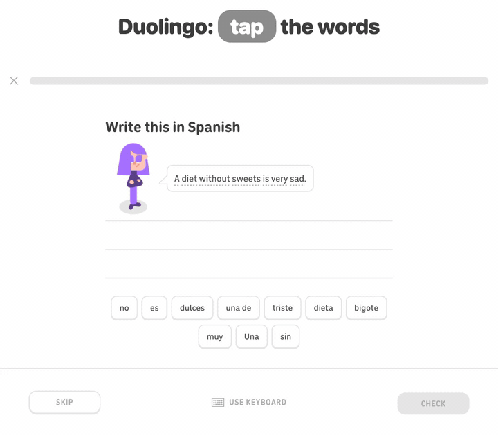

# Duolingo Hard Mode

[](https://chromewebstore.google.com/detail/duolingo-hard-mode/jceggbkbebgncehlbekabbkfhdecfihh)
[](https://chromewebstore.google.com/detail/duolingo-hard-mode/jceggbkbebgncehlbekabbkfhdecfihh)
[](https://github.com/Stupidoodle/duolingo-hard-mode/actions/workflows/ci.yml)
[](https://github.com/Stupidoodle/duolingo-hard-mode/actions/workflows/codeql-analysis.yml)
[](https://codecov.io/github/Stupidoodle/duolingo-hard-mode)

Duolingo lets you pass a lesson by tapping word bubbles. This Chrome extension hides them, so you have to type every answer yourself: recall instead of recognition.



**[Install it from the Chrome Web Store](https://chromewebstore.google.com/detail/duolingo-hard-mode/jceggbkbebgncehlbekabbkfhdecfihh)**

A Firefox version (Firefox 142 or later) is built and tested and is on its way to Firefox Add-ons. Until it is listed there, `bun run firefox` runs it from source.

## What it changes

| Exercise | Duolingo | Hard Mode |
| --- | --- | --- |
| Translations and fill-in-the-blank with a word bank | Tap the bubbles | Type the sentence; each bubble fills in as you finish its word |
| Multiple choice | Pick one of three or four options | The options are hidden until you type one |
| Chat replies | Pick the right reply | Type it; punctuation is optional |
| Matching pairs | Tap two tiles | Hear or read a prompt, type its partner, press Enter |
| Conjugation tables and cloze | Tap the endings | Type them |

Duolingo still grades every answer itself. The extension maps what you type onto the hidden bubbles and taps them for you, so nothing about grading, hearts, XP or streaks is reimplemented.

Exercises that already ask you to type (`listen`, `listenComplete`, `completeReverseTranslation`, `name`) are left as they are. Speaking exercises and `listenIsolation`, whose choices are audio only, cannot be typed.

### Settings

- Ignore accents (`é` = `e`, `œ` = `oe`) and apostrophes, for keyboards that make them a pain
- Turn it off from the toolbar when you want the bubbles back
- Optional on-page buttons for both
- Follows Duolingo's light and dark theme
- Japanese and Chinese: reads furigana and pinyin correctly and works with IME input

No account, no analytics and no network requests. The only permission is `storage`, for those settings.

## How it works

A content script watches the page with a `MutationObserver` and rebuilds each challenge Duolingo renders, keyed off its `data-test` attributes. A few things that made that harder than it sounds:

- **Duolingo is a single-page app.** Entering a lesson from the home screen commits the challenge container before its word bank, so a challenge is only marked as handled once its typing input is in place; otherwise the next mutation retries.
- **Bubbles cannot always be tapped.** A released bubble animates back to the bank and ignores clicks until it lands. Every tap goes through a queue that waits for its target and keeps the order, so fast typing never drops a word.
- **Pair selection is invisible to the DOM.** Duolingo shows the selected tile only through the Web Animations API. The extension never guesses at it, and only Enter commits a pair, because a wrong pair costs a heart.
- **Tables and cloze put a hidden copy of every choice in every blank.** Taps on the hidden copies are ignored, so only visible bubbles are considered.
- **Ruby text.** Japanese tokens interleave their readings in `<rt>`, so `textContent` of すし is `すsuしshi`. Words are read without them.

Rare exercise types such as conjugation tables never came up in about 60 sampled sessions. They were verified by injecting a synthetic challenge into a real session payload, so Duolingo's own renderer drew and graded it, and the test fixtures are built from that DOM.

The test suite runs on Jest and jsdom against Duolingo-shaped markup. CI builds with bun; merging a release PR cuts a GitHub release and publishes it to the Chrome Web Store through the API, and a scheduled job retries while an earlier version is still in review.

## Manual installation

1. Download `extension.zip` from the [latest release](https://github.com/Stupidoodle/duolingo-hard-mode/releases/latest) and extract it; it contains an `extension` folder
2. Open `chrome://extensions` and enable Developer Mode
3. Click "Load unpacked" and select the `extension` folder

## Building from source

This project uses [bun](https://bun.sh).

```bash
bun install
bun run build       # production build into dist/
bun run build:dev   # development build
bun run watch       # rebuild on change
bun run test        # jest with coverage (not `bun test`, which skips jest)
bun run build:firefox  # Firefox package into build/firefox
bun run firefox     # open Firefox with the add-on installed
```

The repository root is a loadable extension once built: "Load unpacked" on the repo root picks up `manifest.json` and `dist/`.

The Firefox manifest is generated from `manifest.json` (an event page instead of the service worker, plus the gecko id and data-collection declaration), so there is only one manifest to edit. Release Firefox only accepts signed add-ons, which is why `bun run firefox` installs it temporarily.

## Contributing

Bug reports are welcome, especially for exercises that become impossible to finish. If Duolingo shows you an exercise the extension leaves alone, an issue with a screenshot helps.

## Disclaimer

Unofficial and not affiliated with or endorsed by Duolingo.
